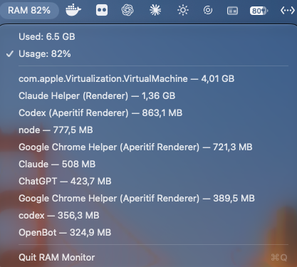

# RAM Menubar

A small macOS menu bar app that shows your live RAM usage.



- Menu bar shows `RAM NN%` or `RAM X.X GB`
- Click **Used** or **Usage** to switch between GB and % (the checked row is active)
- The dropdown lists the top 10 processes by memory

## Requirements

- macOS 13 or later
- Xcode Command Line Tools for the Swift toolchain (`xcode-select --install`)

## Install

```bash
git clone https://github.com/alex0sp/my-menubar.git
cd my-menubar
./scripts/build-app.sh
open build/RAMMenubar.app
```

## Start automatically at login

1. Open **System Settings → General → Login Items & Extensions**.
2. Under **Open at Login**, click **+** and select `RAMMenubar.app`.

Keep the app at the path you added. If you move it, remove the entry and add it again.
